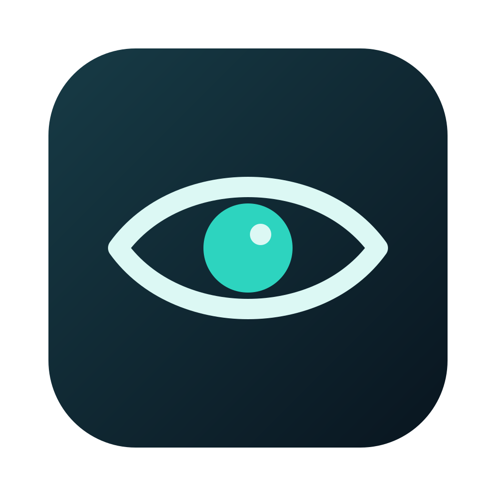

<p align="center"></p>

# Harmony

A native macOS focus app with an offline floating video player, timed sessions, and an optional iPhone helper.

[](https://github.com/cmrcode99/Harmony/actions/workflows/check.yml)

**Early beta.** Harmony is ready for testing and contributions. Installation, permissions, and recovery still need real-device testing across supported Macs.

## Start here

| | Requirements |
| --- | --- |
| Run the app | macOS 13 or later, with a build for your Mac's architecture |
| Build from source | Xcode 26+ Command Line Tools / macOS SDK 26+, Swift, and Python 3 |
| Optional phone helper | A Mac and iPhone that support [iPhone Mirroring](https://support.apple.com/120421) |

From a fresh checkout:

```sh
git clone https://github.com/cmrcode99/Harmony.git
cd Harmony
./setup.sh --check --video /path/to/your-video.mp4
./setup.sh --video /path/to/your-video.mp4
```

The first command checks requirements without changing files. The second builds and installs `~/Applications/Harmony.app` and `~/.local/bin/harmony`, then opens setup. If developer tools are missing, run `xcode-select --install`; an older SDK may need updating to meet the build requirement. [Apple lists supported build systems](https://developer.apple.com/xcode/system-requirements/).

Choose the apps you want available and save the generated recovery password somewhere accessible. **Setup does not start a focus session.** Enable Harmony in **System Settings → Privacy & Security → Accessibility** for window control. Screen Recording is needed only for the phone helper.

Use an MP4 your Mac can play. Videos stay local and are excluded from Git; bring media you have permission to use. For several videos, edit `media/playlist.json` and run `./setup.sh`. Missing files are skipped, but at least one video is required. `--video` adds your supplied video with no intro trim.

If you received a prebuilt package, unzip it and run **Install Harmony.command**. It needs no developer tools or Python. Current local builds are signed but not Apple-notarized, so macOS may require approval in Privacy & Security.

## Focus sessions

**Harmony force-quits apps outside your allowed list. Save work before starting.** Finder and System Settings stay available. Approved apps are opened and their windows minimized once; cmux stays unminimized.

```sh
~/.local/bin/harmony          # start untimed focus mode
~/.local/bin/harmony 0 45     # start a 45-minute lock
~/.local/bin/harmony help     # all commands
```

Add `export PATH="$HOME/.local/bin:$PATH"` to your shell configuration if you want to use the shorter `harmony` command. The installer leaves your shell configuration alone.

| Command | Action |
| --- | --- |
| `harmony 1` | Start a one-hour lock; whole hours range from 1–5. |
| `harmony extend 2 30` | Set 2 hours 30 minutes remaining from now, without shortening. |
| `harmony hide` / `harmony unhide` | Hide or show the video; keep the session running. |
| `harmony exit` | Exit untimed mode. Timed early exit uses the eye menu and recovery password. |
| `harmony setup` | Open first-run configuration while the app is off. |
| `harmony phone` | Verify your password and enter the saved phone code. |

Durations range from one minute to five hours. Repeating a start command leaves an existing session unchanged. Time asleep counts toward the deadline; an unfinished timed session can recover after a crash or login. Harmony is a personal focus aid. It does not filter websites or commands inside allowed apps or provide an administrator-enforced lock.

Click the video to pause/resume; hover for volume, seeking, and Skip. The eye menu controls visibility, size, movement, sound, and exit. Pausing or hiding the video does not pause the timer.

## Update or uninstall

Finish the current session and exit Harmony before updating. Rerun `./setup.sh` from an updated checkout, or run a newer package's installer. Updates keep your settings; installation rolls back if replacement fails.

```sh
harmony uninstall                 # remove the app, CLI, and recovery service
# Or, from this checkout:
./uninstall.sh
```

Uninstall keeps settings and the encrypted phone vault. Add `--remove-data` to explicitly delete them. Active sessions must end first. See [local data and recovery](docs/local-data.md) before changing passwords or removing data.

## Optional iPhone helper

Configure Screen Time and iPhone Mirroring on your devices first. With Harmony off, run `sharing/Setup iPhone.command`, enter your Harmony recovery password, then your existing four-digit Screen Time code. The helper stores an encrypted copy locally; it does not change the phone's code.

Enable Screen Recording for Harmony, open Mirroring at an empty Screen Time passcode prompt, then run `harmony phone`. The helper checks the screen before every digit and stops when it cannot verify the target. Reconfigure it after changing the phone code or Harmony password.

## Development

```sh
make check                                     # tests, typecheck, and source privacy checks
./build.sh --stage-only /tmp/Harmony.app        # signed review build; destination must be new
make share                                     # local ZIP and checksum; nothing uploaded
```

Read [CONTRIBUTING.md](CONTRIBUTING.md) for code layout and checks, [release notes](CHANGELOG.md) for changes, and [SECURITY.md](SECURITY.md) to report a security issue. Agents can start with [AGENTS.md](AGENTS.md).

The eye icon is original artwork generated from source. See [release preparation](docs/releases.md) for signing and package options.

Harmony is available under the [MIT license](LICENSE). Videos, custom icons, and other third-party media retain their own licenses and permissions.
