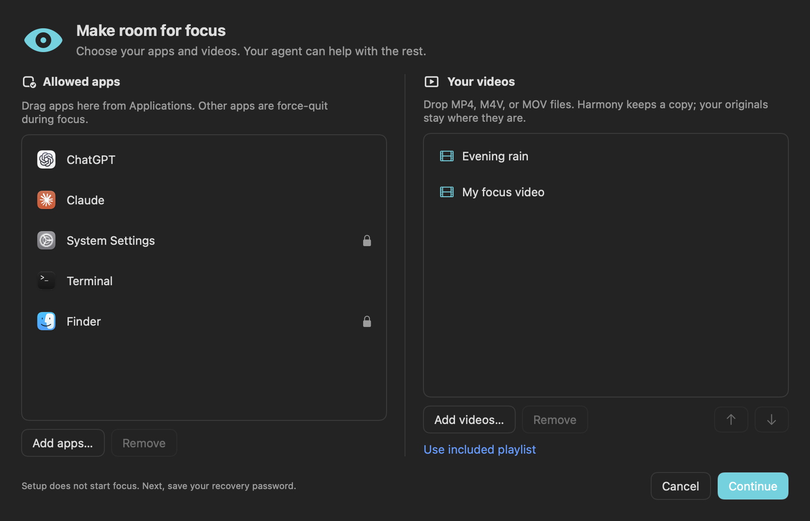

<p align="center"></p>

# Harmony

A native macOS focus app with an offline floating video player, timed sessions, and an optional iPhone helper.

[](https://github.com/cmrcode99/Harmony/actions/workflows/check.yml)

**Early beta.** Harmony is ready for testing and contributions. Installation, permissions, and recovery still need real-device testing across supported Macs.

## Set up with your agent

Give your agent this repository or the downloaded Harmony folder and say:

> Help me set up Harmony. Read [the setup guide](sharing/AGENT_SETUP.md), handle the computer steps, and explain what I need to do myself. Get the Mac app working first; ask about the optional phone helper afterward.

Your agent handles installation and verification. You choose your allowed apps, save your recovery password, and approve macOS permissions. Enter passwords in the app's local windows, never in chat. Phone setup is optional.

## Apps and videos, your way

Choose **Allowed apps** or **Allowed videos** below **Move window** in the eye menu. Each opens the matching settings area and Finder, ready to drag files in. The application menu also has **Apps and videos**, and `harmony setup` works while it is off. Drag applications from Finder into **Allowed apps**, and drop your own videos into **Allowed videos**. Add/remove buttons work too; the arrows change playback order. Finder and System Settings always stay allowed.

<p align="center"><br><em>Settings window with sample data.</em></p>

Videos are copied into Harmony's local library. Removing one deletes only that copy; your original file stays put. Changes persist through updates. Settings pause untimed focus while open, and remain locked during timed sessions.

You can add, reorder, or remove videos in one custom playlist, then choose **Use included playlist** to switch back. The default video files are hosted in the [default playlist release](https://github.com/cmrcode99/Harmony/releases/tag/default-videos-v1), and setup downloads them automatically.

To remove allowed apps, select a row, or Command-click/Shift-click several rows, then click **Remove apps** and **Save changes**. This changes the allowlist; it does not delete the apps from your Mac. Finder and System Settings always stay allowed.

## Set up yourself

| | Requirements |
| --- | --- |
| Run the app | Apple Silicon Mac with macOS 13 or later |
| Build from source | Xcode 26+ Command Line Tools / macOS SDK 26+, Swift, and Python 3 |
| Optional phone helper | A Mac and iPhone that support [iPhone Mirroring](https://support.apple.com/120421) |

From a fresh checkout:

```sh
git clone https://github.com/cmrcode99/Harmony.git
cd Harmony
./setup.sh --check
./setup.sh
```

The first command checks requirements without changing files. The second builds and installs `~/Applications/Harmony.app` and `~/.local/bin/harmony`, then opens setup. If developer tools are missing, run `xcode-select --install`; an older SDK may need updating to meet the build requirement. [Apple lists supported build systems](https://developer.apple.com/xcode/system-requirements/).

Setup downloads the four default videos (about 472 MiB) from GitHub, verifies them, and preserves any existing local videos. To skip the download and add your own videos in the app, run `./setup.sh --no-default-videos`. An interrupted download can be retried by running setup again.

Choose the apps you want available and save the generated recovery password somewhere accessible. **Setup does not start a focus session.** In **System Settings → Privacy & Security**, allow Harmony under **Accessibility** or **Device Control and Data Access**, depending on your macOS version. This permission lets Harmony minimize windows. Screen Recording is needed only for the phone helper.

Add MP4, M4V, or MOV videos in the settings window, during setup or later. Videos stay local. No video file is required to build or install. Developers can still bundle a playlist through `media/playlist.json` or pass `--video /path/to/video.mp4` to setup.

If you received a prebuilt package, unzip it and run **Install Harmony.command**. It needs no developer tools or Python. Current local builds are signed but not Apple-notarized, so macOS may require approval in Privacy & Security.

## Focus sessions

**Harmony force-quits apps outside your allowed list. Save work before starting.** Finder and System Settings stay available. Approved apps are opened and their windows minimized once; approved cmux stays unminimized. Other terminal apps need to be allowed and may be minimized. Reopen any approved app when you need it; Harmony does not keep minimizing it during the session.

```sh
~/.local/bin/harmony          # start untimed focus mode
~/.local/bin/harmony 0 45     # start a 45-minute lock
~/.local/bin/harmony help     # all commands
```

Add `export PATH="$HOME/.local/bin:$PATH"` to your shell configuration if you want to use the shorter `harmony` command. The installer leaves your shell configuration alone.

| Command | Action |
| --- | --- |
| `harmony 1` | Start a one-hour lock; whole hours range from 1–5. |
| `harmony extend 2 30` | Set 2 hours 30 minutes remaining from now, without shortening. |
| `harmony hide` / `harmony unhide` | Hide or show the video; keep the session running. |
| `harmony exit` | Exit untimed mode. Timed early exit uses the eye menu and recovery password. |
| `harmony setup` | Open first-run configuration while the app is off. |
| `harmony setup phone` | Configure the optional phone helper while the app is off. |
| `harmony phone` | Verify your password and enter the saved phone code. |

Durations range from one minute to five hours. Repeating a start command leaves an existing session unchanged. Time asleep counts toward the deadline; an unfinished timed session can recover after a crash or login. Harmony is a personal focus aid. It does not filter websites or commands inside allowed apps or provide an administrator-enforced lock.

Click the video to pause/resume; hover for volume, seeking, and Skip. The eye menu controls visibility, size, movement, sound, and exit. Pausing or hiding the video does not pause the timer.

## Update or uninstall

Finish the current session and exit Harmony before updating. Rerun `./setup.sh` from an updated checkout, or run a newer package's installer. Updates keep your settings; installation rolls back if replacement fails. macOS may ask you to approve window-control or phone permissions again after an update. If windows stop minimizing, end the session, check Harmony's permission in Privacy & Security, and quit Harmony before trying again.

```sh
harmony uninstall                 # remove the app, CLI, and recovery service
# Or, from this checkout:
./uninstall.sh
```

Uninstall keeps settings and the encrypted phone vault. Add `--remove-data` to explicitly delete them. Active sessions must end first. See [local data and recovery](docs/local-data.md) before changing passwords or removing data.

## Optional iPhone helper

The Mac app works without phone setup. If you want it, ask your agent to follow [the phone setup steps](sharing/AGENT_SETUP.md#3-offer-the-phone-helper-with-skip-for-now-as-a-complete-outcome).

You choose Screen Time limits on your iPhone and connect iPhone Mirroring first. Then, with Harmony off, run `harmony setup phone`. Enter your **Harmony recovery password** and your existing **Screen Time passcode** in the local windows. These are different credentials. Harmony keeps an encrypted copy of the phone code; it does not change Screen Time settings.

Screen Recording permission is needed for this experimental helper. To use it, open Mirroring at an empty Screen Time passcode prompt and run `harmony phone` during a Harmony session. Reconfigure it after changing either credential.

## Development

```sh
make check                                     # tests, typecheck, and source privacy checks
./build.sh --stage-only /tmp/Harmony.app        # signed review build; destination must be new
make share                                     # local ZIP and checksum; nothing uploaded
```

Read [CONTRIBUTING.md](CONTRIBUTING.md) for code layout and checks, [release notes](CHANGELOG.md) for changes, and [SECURITY.md](SECURITY.md) to report a security issue. Agents can start with [AGENTS.md](AGENTS.md).

The app uses the original character icon selected by the maintainer. See [release preparation](docs/releases.md) for signing and package options.

Harmony is available under the [MIT license](LICENSE). Videos, custom icons, and other third-party media retain their own licenses and permissions.
